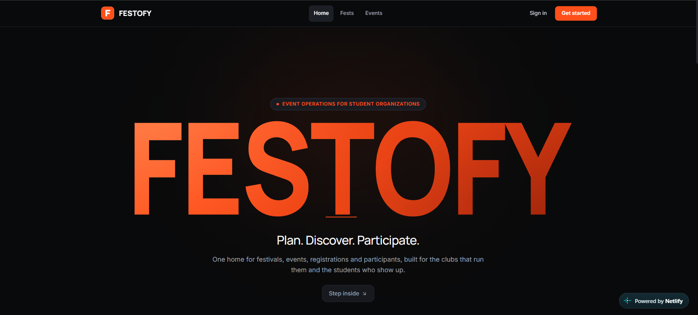
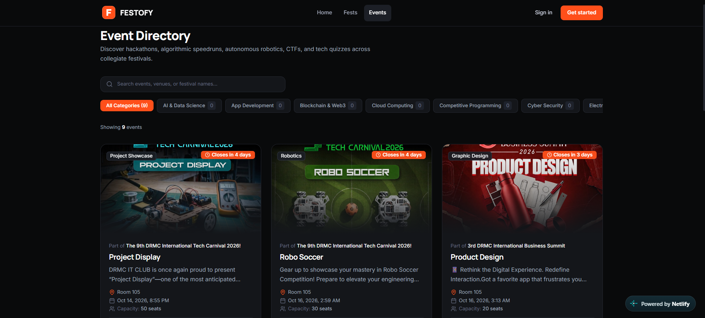
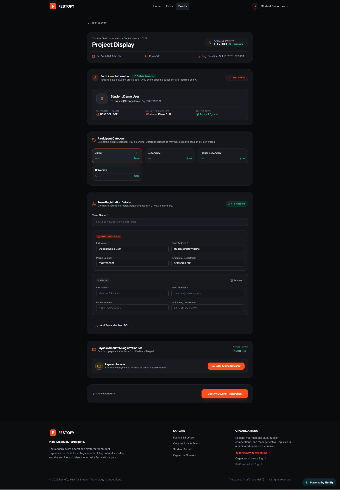
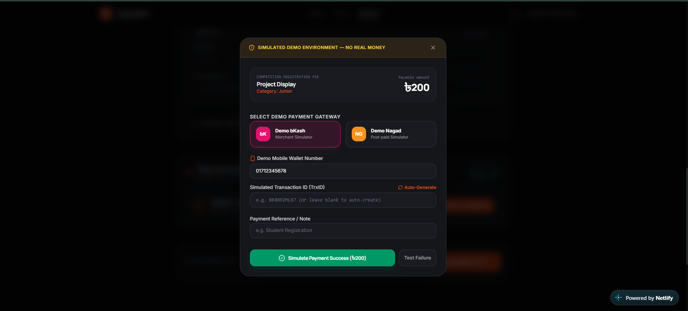
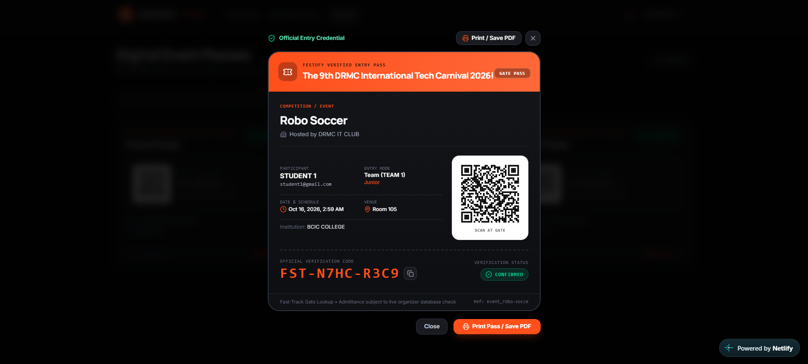
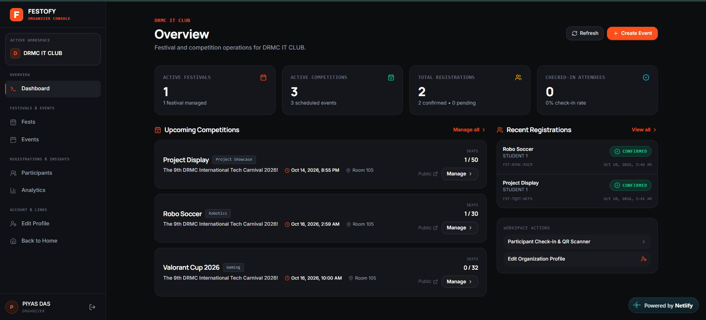
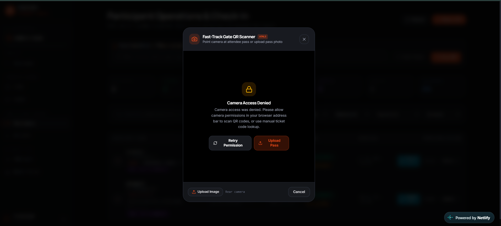
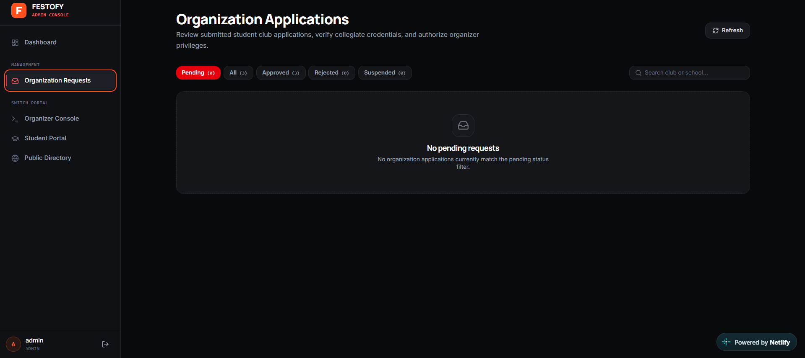

# Festofy

> **Event Operations for Student Organizations — Plan. Discover. Participate.**

Festofy is a high-reliability, multi-tenant event operations and management platform designed specifically for collegiate festivals, hackathons, and student organizations. It bridges the gap between campus clubs hosting complex multi-track summits and students discovering, registering for, and attending competitions and workshops.

---

## Table of Contents

- [1. Project Description](#1-project-description)
- [2. Features](#2-features)
  - [Student Features](#student-features)
  - [Organizer Features](#organizer-features)
  - [Admin Features](#admin-features)
  - [Registration System & Integrity](#registration-system--integrity)
  - [UI/UX & Accessibility](#uiux--accessibility)
- [3. Technology Stack](#3-technology-stack)
- [4. Prerequisites and Setup Instructions](#4-prerequisites-and-setup-instructions)
  - [Prerequisites](#prerequisites)
  - [Installation & Local Setup](#installation--local-setup)
  - [Environment Variables](#environment-variables)
  - [Database Initialization](#database-initialization)
  - [Development & Build Commands](#development--build-commands)
- [5. Deployment URL](#5-deployment-url)
- [6. Demo Credentials & Evaluation Workflow](#6-demo-credentials--evaluation-workflow)
- [7. Third-Party Services and APIs](#7-third-party-services-and-apis)
- [8. AI Tools and AI Features](#8-ai-tools-and-ai-features)
- [9. Screenshots](#9-screenshots)
- [10. Known Limitations](#10-known-limitations)
- [11. Additional Documentation](#11-additional-documentation)
- [12. License](#12-license)

---

## 1. Project Description

Student-run festivals and academic olympiads often face administrative bottlenecks: lost registrations, oversold venues, double-check-ins, and chaotic gate lines. Festofy addresses these challenges through a centralized, role-based architecture structured around a strict relational hierarchy:

$$\text{Organization} \longrightarrow \text{Fest} \longrightarrow \text{Event} \longrightarrow \text{Registration}$$

### Core Hierarchy

1. **Organization (Clubs & Societies)**: The governing host entity (e.g., *DRMC IT Club*, *BCIC College IT Club*). Student users can apply to establish an organization, which must be vetted and approved by platform administrators before fests can be published.
2. **Fest (Festival / Summit)**: A multi-day collegiate festival hosted by an approved organization (e.g., *DRMC National Tech Carnival 2026*). Sets broad festival dates, banners, and default visitor access policies.
3. **Event (Competition / Track)**: An individual contest, hackathon, workshop, or challenge nested within a specific festival. Defines schedules, venue details, capacity limits, registration fees, custom form questions, and participant category eligibility.
4. **Registration (Participant Pass)**: The unique entry credential linking a student or team to an event. Registrations enforce concurrency limits, record payment references, and produce verifiable digital entry passes.

---

## 2. Features

### Student Features
- **Public Event & Festival Discovery**: Search and explore upcoming campus festivals and competitions with multi-dimensional filtering by category, host organization, and event status.
- **Campus Visitor Policy Visibility**: Clear visual indicators showing whether campus visitors are allowed or restricted for each festival and competition.
- **Multi-Category Eligibility**: Support for distinct participant tracks (School, College, University, Open) with category-specific pricing and eligibility checks.
- **Dynamic Custom Questionnaire Forms**: Submit event-specific questionnaire fields (e.g., GitHub profiles, team member rosters, t-shirt sizes).
- **Standards-Compliant Digital Gate Pass**: Automatic generation of high-contrast, ISO/IEC 18004 scannable vector SVG QR codes with Level-M error correction.
- **Print & PDF Credential Support**: Dedicated print stylesheet (`@media print`) that isolates the official badge and ticket code while stripping extraneous web UI for physical accreditation.
- **Personalized Event Recommendations**: Algorithmic matching between student profile interests (e.g., Competitive Programming, Robotics, AI, Physics) and published competition topic tags.
- **Notification Inbox**: Real-time notifications for event recommendations and registration status updates.
- **Profile Completion Tracker**: Interactive profile progress indicator calculating completeness based on contact info, institutional affiliation, and profile photo upload.
- **Self-Service Seat Cancellation**: Option for students to cancel pending or confirmed entries prior to event deadlines, automatically freeing seat capacity for other participants.

### Organizer Features
- **Multi-Club Console**: Context-aware workspace switcher scoped strictly to organizations where the user holds verified membership.
- **Festival & Event Lifecycle Management**: Draft, edit, publish, complete, and archive festivals and competitions with automated schedule validation (`registrationDeadline <= startTime <= endTime`).
- **Participant Manifest & Live Roster**: Searchable participant tables displaying registration metadata, contact information, team rosters, and payment details.
- **1-Tap Rapid Gate Check-In**: Integrated camera QR code scanner and manual ticket code lookup with anti-double-check-in verification and instant status feedback.
- **Formula-Sanitized CSV Roster Export**: One-click participant manifest export that automatically neutralizes spreadsheet formula injection risks (`=`, `+`, `-`, `@`).
- **Real-Time Capacity & Attendance Analytics**: Live breakdown of quota utilization, confirmed attendees, checked-in participant percentage, and team-vs-individual distribution.
- **Custom Registration Form Template Builder**: Create and save reusable form templates with custom question types (text, textarea, dropdown, radio, checkbox, number, file link).

### Admin Features
- **Platform Administration Console**: System-wide dashboard monitoring registered student organizations, pending applications, and master taxonomy.
- **Atomic Club Approval Workflow**: Approving an organization request promotes the applicant to the `organizer` role and creates an `owner` membership document within an atomic transaction.
- **Master Taxonomy Management**: Centralized master event categories (Programming, Robotics, Cyber Security, Olympiad, etc.) with group taxonomies.
- **Direct Demo Role Verification**: Automated verification scripts ensuring administrator privileges and credentials remain synchronized with database security rules.

### Registration System & Integrity
- **Concurrency & Double-Booking Prevention**: Deterministic document keys (`{eventId}_{userId}`) enforce uniqueness at the database engine level, physically preventing duplicate concurrent registrations.
- **Atomic Capacity Tracking**: Event registration count updates (`currentRegistrations`) execute within atomic transactions that prevent overbooking beyond capacity limits.
- **Demo MFS Payment Simulator**: Interactive sandbox simulator for bKash and Nagad mobile financial services (MFS), providing realistic verification flows with transaction IDs without processing real money.

### UI/UX & Accessibility
- **Performance & Aesthetics**: Dark-mode industrial interface built with Tailwind CSS v4, Manrope typography, and smooth micro-interactions via Motion.
- **Responsive Layouts**: Fully responsive multi-layout architecture with drawer navigation on mobile and console sidebars on desktop.
- **Accessible State Handling**: Comprehensive empty states, loading skeletons, and confirmation dialogs for destructive actions.
- **Global Route Scroll Restoration**: Automatic scroll restoration to top of page on route transitions.

---

## 3. Technology Stack

| Layer | Technology | Version | Purpose |
|---|---|---|---|
| **Frontend Framework** | [React](https://react.dev/) | `^19.0.1` | Component-driven UI architecture |
| **Language** | [TypeScript](https://www.typescriptlang.org/) | `^7.0.2` | End-to-end type safety and interface contracts |
| **Build Tool & Bundler** | [Vite](https://vite.dev/) | `^8.3.0` | High-speed ESM development server and production bundler |
| **Styling** | [Tailwind CSS](https://tailwindcss.com/) | `^4.3.3` | Utility-first styling via modern `@tailwindcss/vite` |
| **Routing** | [React Router](https://reactrouter.com/) | `^7.18.4` | Client-side declarative routing and protected navigation |
| **Database** | [Google Cloud Firestore](https://firebase.google.com/docs/firestore) | `^12.19.0` | Multi-tenant NoSQL document database with Security Rules v2 |
| **Authentication** | [Firebase Authentication](https://firebase.google.com/docs/auth) | `^12.19.0` | Email/Password and Google OAuth identity management |
| **Icons** | [Lucide React](https://lucide.dev/) | `^0.546.0` | Lightweight, consistent SVG icon system |
| **Motion & Animation** | [Motion](https://motion.dev/) | `^12.23.24` | Fluid UI transitions and modal enter/exit animations |
| **QR Code Engine** | [qrcode](https://github.com/soldair/node-qrcode) | `^1.5.4` | ISO/IEC 18004 standards-compliant SVG ticket pass generation |
| **QR Code Scanner** | [jsqr](https://github.com/cozmo/jsQR) & [html5-qrcode](https://github.com/mebjas/html5-qrcode) | `^1.4.0` / `^2.3.8` | Real-time camera stream decoding and barcode parsing |
| **Local Runtime / Scripting** | [Node.js](https://nodejs.org/) & [tsx](https://github.com/privatenumber/tsx) | `22.x` / `^4.21.0` | Script execution, testing harnesses, and dev server runtime |

---

## 4. Prerequisites and Setup Instructions

### Prerequisites

Ensure you have the following installed locally:
- **Node.js**: `v20.x` or `v22.x` (LTS recommended)
- **npm**: `v10.x` or higher (bundled with Node.js)
- **Git**: Installed and configured on your system

### Installation & Local Setup

1. **Clone the repository**:
   ```bash
   git clone https://github.com/Piyas151323/Festofy.git
   cd Festofy
   ```

2. **Install project dependencies**:
   ```bash
   npm install
   ```

3. **Configure environment variables**:
   Create a local `.env` configuration by copying the provided example:
   ```bash
   cp .env.example .env
   ```

### Environment Variables

The project reads Firebase configuration settings. The repository contains a pre-linked `firebase-applet-config.json` file for the contest evaluation database. For custom environments, provide the following variables in `.env`:

| Variable Name | Required | Description |
|---|---|---|
| `FIREBASE_API_KEY` | Optional / Custom | Google Firebase web API key |
| `FIREBASE_APP_ID` | Optional / Custom | Firebase web application identifier |
| `FIREBASE_AUTH_DOMAIN` | Optional / Custom | Firebase authentication domain (e.g. `project.firebaseapp.com`) |
| `FIREBASE_FIRESTORE_DATABASE_ID` | Optional / Custom | Specific Firestore named database identifier |
| `FIREBASE_MESSAGING_SENDER_ID` | Optional / Custom | FCM messaging sender ID |
| `FIREBASE_PROJECT_ID` | Optional / Custom | Google Cloud / Firebase project ID |
| `FIREBASE_STORAGE_BUCKET` | Optional / Custom | Firebase Storage Google Cloud Storage bucket |
| `GEMINI_API_KEY` | Optional | API key for Gemini SDK server-side extensions |

> **Security Note:** Never commit production API keys, service account JSON files, or secret tokens to version control. The repository uses client-side Firebase configurations protected by strict backend Firestore Security Rules (`firestore.rules`).

### Database Initialization

To populate the default competition categories and ensure the platform administrator role is provisioned in Firestore:

```bash
npx tsx src/scripts/initFirestore.ts
```

To verify the administrator account status:

```bash
npx tsx src/scripts/verifyAdminAccount.ts
```

### Development & Build Commands

- **Start Development Server**:
  ```bash
  npm run dev
  ```
  The app will be accessible at `http://localhost:3000`.

- **Type Check & Lint**:
  ```bash
  npm run lint
  ```

- **Build for Production**:
  ```bash
  npm run build
  ```
  Generates production-optimized static assets in the `dist/` directory.

- **Preview Production Build**:
  ```bash
  npm run preview
  ```

- **Run Automated Test Suites**:
  ```bash
  # Phase 1: Comprehensive registration, payment, profile & concurrency tests (28/28)
  npx tsx src/test_phase1_comprehensive.ts

  # Phase 5: Security rules, role escalation, and lifecycle invariants (44/44)
  npx tsx src/test_phase5_security_remediation.ts
  ```

---

## 5. Deployment URL

- **Production Deployment (Netlify)**: [https://festofy.netlify.app/](https://festofy.netlify.app/)
- **Live Preview Environment**: [https://ais-dev-gbso7slmtargfivjg4c4rv-300568616465.asia-east1.run.app](https://ais-dev-gbso7slmtargfivjg4c4rv-300568616465.asia-east1.run.app)
- **Alternate Custom Deployment**: `[Add your deployed application URL]`

---

## 6. Demo Credentials & Evaluation Workflow

The following demo accounts are provided for competition evaluation. Use the credentials listed for each account type. The administrator demo credentials are displayed directly in the admin demo UI and are intentionally not duplicated here.

### Platform Administrator

| Role | Credentials | Access URL | Capabilities |
|---|---|---|---|
| **Platform Administrator** | Use the demo credentials displayed in the admin demo UI. | `/admin/login` | Review organization requests, manage platform event categories, and access platform administration tools. |

### Organization Demo Accounts

All organization demo accounts use the same password.

| Account | Email | Password | Access URL |
|---|---|---|---|
| DRMC BAC Club | `drmcbacclub@gmail.com` | `12345678` | `/organizer/login` |
| DRMC IT Club | `drmc-it-club@gmail.com` | `12345678` | `/organizer/login` |
| NDC | `ndsecndc@gmail.com` | `12345678` | `/organizer/login` |

Organization accounts can access the organizer workspace and the organization features permitted for their account.

### Student Demo Account

| Role | Email | Password | Access URL | Capabilities |
|---|---|---|---|---|
| **Student Participant** | `student1@gmail.com` | `12345678` | `/auth` | Browse fests and events, register for events, manage the student profile, and view registration or ticket details. |

### Evaluation Walkthrough

1. **Public Discovery Flow**:
   - Visit `/` (Homepage) to view featured festivals and upcoming competitions.
   - Navigate to `/fests` to browse collegiate festivals and filter by category or host.
   - Visit `/events` to explore event schedules, venues, fees, and visitor policies.
2. **Student Journey**:
   - Go to `/auth` and sign in with `student1@gmail.com` and password `12345678`.
   - Open an event and complete the registration form. For paid demo events, use the demo bKash/Nagad payment simulator if available.
   - Review registration details and the digital ticket or QR pass provided by the application.
3. **Organization Journey**:
   - Go to `/organizer/login` and sign in with one of the organization demo accounts listed above.
   - Access the organizer workspace and test the organization features available to that account, such as managing fests and events or reviewing participants.
4. **Platform Governance Flow**:
   - Navigate to `/admin/login` and use the administrator demo credentials shown in the admin demo UI.
   - Review organization requests and test the available administration features.

> **Demo account note:** These credentials are intended for evaluation/demo use only. Do not reuse the shared demo password for personal accounts.

---

## 7. Third-Party Services and APIs

The application integrates with the following external services and APIs:

1. **[Firebase Authentication](https://firebase.google.com/docs/auth)**:
   - Provides user authentication via Email/Password and Google OAuth (`GoogleAuthProvider`).
   - Handles secure JWT token management and auth state synchronization.
2. **[Google Cloud Firestore](https://firebase.google.com/docs/firestore)**:
   - Manages all operational application data across collections (`users`, `userRoles`, `organizations`, `organizationMembers`, `fests`, `events`, `registrations`, `notifications`, `registrationFormTemplates`, `eventCategories`).
   - Protected by declarative server-side [Firestore Security Rules v2](firestore.rules).
3. **[Google Fonts](https://fonts.google.com)**:
   - Imports typography styles: **Inter** (body copy) and **Manrope** (display headings).
4. **[Unsplash Images](https://unsplash.com)**:
   - Provides curated, high-resolution festival and competition header photography via secure CDN endpoints.

---

## 8. AI Tools and AI Features

### AI Tools Disclosure (Development)

In accordance with the competition rules, the following AI tools assisted during the development of Festofy:

* [**Google AI Studio**](https://aistudio.google.com/): Used for application development, architecture design, UI prototyping, TypeScript code generation, Firestore security rule auditing, and automated test development.
* [**ChatGPT**](https://chatgpt.com/): Used for prompt engineering, preparing structured development instructions, refining prompts for AI-assisted coding, and organizing implementation tasks into manageable phases.


### AI-Powered Features (Application Runtime)

- **Algorithmic Interest Matching**: The application currently features a heuristic recommendation engine implemented in TypeScript (`src/services/notificationService.ts`). It matches a student's configured academic interests with published event topics and category tags to deliver personalized event suggestions and notification alerts.
- **Gemini SDK Integration**: The project includes `@google/genai` in `package.json` with server-side proxy capabilities configured. This is architected for future AI extensions, including natural language event semantic search and AI-assisted festival scheduling.

---

## 9. Screenshots

Screenshots are stored in `docs/screenshots/`. Add the image files using the filenames below and they will render directly in this README on GitHub.

### Homepage



### Event Discovery and Filters



### Event Registration Form



### Demo Payment Simulator



### Digital Gate Pass



### Organizer Console



### QR Check-In Scanner



### Admin Organization Approval



> **Add your screenshots:** Create the `docs/screenshots/` directory in the project root, save each screenshot with the exact filename used above, and commit the images along with `README.md`. Until the image files are added, GitHub will show broken image placeholders. Avoid including private user information in screenshots.

---

## 10. Known Limitations

To provide transparent documentation for judges and evaluators, the following known limitations are noted:

1. **Demo Payment Gateway**: The bKash and Nagad payment flows are implemented using an interactive client-side sandbox simulator for evaluation and demo purposes. Real mobile financial service API webhooks are not connected to live banking rails.
2. **Google OAuth Authorized Domains**: Google Sign-In requires the deployment domain (e.g. `festofy.netlify.app`, `localhost`) to be explicitly whitelisted under **Authorized Domains** in the Firebase Authentication console. If testing on an unlisted domain, the application provides fallback email/password demo authentication.
3. **Image Uploads**: Event and festival banners currently use direct image URLs and curated CDN links. Direct file uploads store image references; persistent blob storage via Firebase Storage requires bucket CORS authorization in standalone environments.
4. **Automated Test Scope**: The project maintains comprehensive test suites for Phase 1 (28/28 passed) and Phase 5 security remediation (44/44 passed). A subset of Phase 2 test assertions check for specific DOM label strings in `StudentHistoryPage` that may differ slightly from the current UI layout.

---

## 11. Additional Documentation

### Contribution Guidelines

1. **Fork & Branch**: Create a feature branch (`git checkout -b feature/my-feature`).
2. **Code Standards**: Maintain TypeScript strict typing and Tailwind CSS v4 design tokens.
3. **Verification**: Run `npm run lint` and verify that the app compiles cleanly with `npm run build`.
4. **Pull Requests**: Submit PRs with clear descriptions of changes and test steps.

### Troubleshooting Guide

- **Port in Use**: If port 3000 is occupied, run `npm run dev -- --port 3001` or free port 3000 (`lsof -i :3000`).
- **Firebase Connection Notices**: If encountering network warnings on initial load, ensure your network allows connections to `*.googleapis.com` and `firestore.googleapis.com`.
- **Admin Access**: If an administrator account loses permissions in Firestore, run `npx tsx src/scripts/initFirestore.ts` to automatically re-verify the `userRoles/{uid}` record.

---

## 12. License

This project is open-source software licensed under the **[MIT License](LICENSE)**.

```
Copyright (c) 2026 Piyas Das
```
